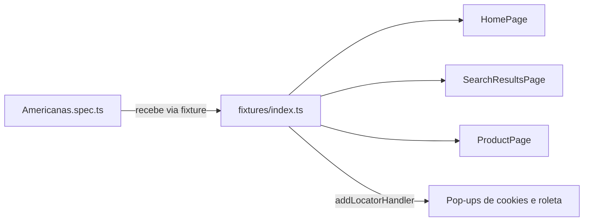
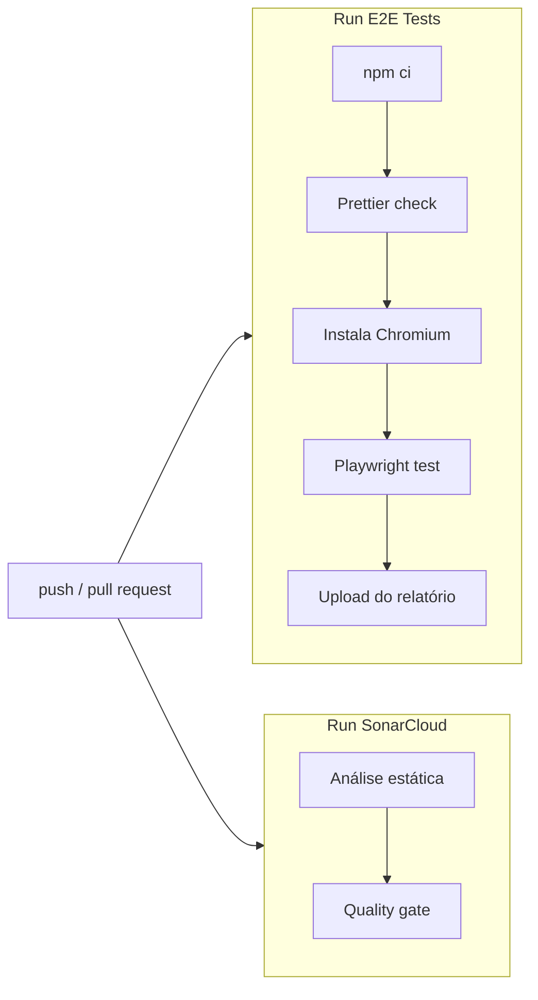

# Testes E2E da Americanas com Playwright

[](https://github.com/minattinho/provae2endminatto/actions/workflows/node.js.yml)
[](https://sonarcloud.io/summary/new_code?id=minattinho_provae2endminatto)
[](https://sonarcloud.io/summary/new_code?id=minattinho_provae2endminatto)
[](https://sonarcloud.io/summary/new_code?id=minattinho_provae2endminatto)

Testes end-to-end do e-commerce [Americanas](https://www.americanas.com.br/) escritos com [Playwright](https://playwright.dev/) e TypeScript. Os testes rodam a cada push no GitHub Actions, e o código passa pela análise estática do SonarCloud.

## Sumário

- [Casos de teste](#casos-de-teste)
- [Tecnologias](#tecnologias)
- [Como executar](#como-executar)
- [Relatórios e evidências](#relatórios-e-evidências)
- [Arquitetura](#arquitetura)
- [Boas práticas do Playwright aplicadas](#boas-práticas-do-playwright-aplicadas)
- [Pipeline de CI](#pipeline-de-ci)
- [Por que Americanas e não OLX](#por-que-americanas-e-não-olx)
- [Solução de problemas](#solução-de-problemas)
- [Créditos](#créditos)

## Casos de teste

Todos os cenários estão em [`src/scenarios/Americanas.spec.ts`](src/scenarios/Americanas.spec.ts) e começam na página inicial do site.

| # | Cenário | Passos | Resultado esperado |
| - | ------- | ------ | ------------------ |
| 1 | Busca com resultados | Buscar "garrafa termica" | URL da busca contém `garrafa-termica` e a lista mostra produtos com "garrafa" no nome |
| 2 | Detalhe do produto | Buscar "garrafa termica" e abrir o primeiro produto | URL de produto (`/p`), título igual ao do card clicado e botão **Comprar** visível |
| 3 | Busca sem resultados | Buscar um termo inexistente (`xyzqwkjhgfdsa`) | Mensagem "nenhum resultado encontrado para xyzqwkjhgfdsa" e nenhum produto listado |

## Tecnologias

| Ferramenta | Uso |
| ---------- | --- |
| [Playwright Test](https://playwright.dev/) 1.63 | Execução dos testes, relatórios, trace e vídeo |
| TypeScript | Linguagem dos testes |
| Node.js 22+ | Ambiente de execução |
| Prettier | Padronização de formatação (validada no CI) |
| GitHub Actions | Execução automática dos testes |
| SonarCloud | Análise estática e quality gate |

## Como executar

### Pré-requisitos

- [Node.js](https://nodejs.org/) 22 ou superior
- Git

### Instalação

```bash
git clone https://github.com/minattinho/provae2endminatto.git
cd provae2endminatto
npm ci
npx playwright install chromium
```

### Rodando os testes

```bash
npm test
```

Saída esperada:

```text
Running 3 tests using 3 workers
  ✓ deve buscar um produto e exibir resultados relacionados
  ✓ deve abrir o detalhe do produto a partir da busca
  ✓ deve informar quando a busca não encontra resultados
  3 passed
```

### Comandos disponíveis

| Comando | O que faz |
| ------- | --------- |
| `npm test` | Roda todos os testes em modo headless |
| `npm run ui` | Abre o modo UI do Playwright para escolher testes e acompanhar cada passo |
| `npx playwright test --headed` | Roda os testes com o navegador visível |
| `npm run debug` | Roda com o Playwright Inspector, passo a passo |
| `npx playwright test -g "detalhe"` | Roda apenas os testes cujo nome contém o texto informado |
| `npm run show-report` | Abre o último relatório HTML |
| `npm run ci` | Mesmo fluxo do pipeline: limpa artefatos, valida formatação e roda os testes |
| `npm run format` | Formata o código com Prettier |

## Relatórios e evidências

Tudo é gerado na pasta `artifacts/` (ignorada pelo Git):

| Caminho | Conteúdo |
| ------- | -------- |
| `artifacts/report/` | Relatório HTML (`npm run show-report`) |
| `artifacts/junit/results.xml` | Resultado em JUnit, para integrar com outras ferramentas |
| `artifacts/media/` | Screenshot, vídeo e trace dos testes que falharam |

Para investigar uma falha passo a passo, abra o trace no [Trace Viewer](https://playwright.dev/docs/trace-viewer):

```bash
npx playwright show-trace artifacts/media/<pasta-do-teste>/trace.zip
```

No GitHub Actions, a mesma pasta fica disponível para download como artifact **playwright-report** em cada execução.

## Arquitetura

```text
src/
├── scenarios/
│   └── Americanas.spec.ts      # casos de teste
└── support/
    ├── fixtures/
    │   └── index.ts             # test.extend: injeta os Page Objects e fecha pop-ups
    └── pages/
        ├── HomePage.ts          # página inicial e busca
        ├── SearchResultsPage.ts # lista de resultados e busca vazia
        └── ProductPage.ts       # detalhe do produto
```



- **Specs** só descrevem o cenário e as validações; não conhecem seletores.
- **Page Objects** guardam os locators como propriedades `readonly` e expõem ações de alto nível (`search`, `openFirstProduct`).
- **Fixtures** criam os Page Objects para cada teste, então nenhum spec precisa instanciá-los.

## Boas práticas do Playwright aplicadas

| Prática | Onde | Documentação |
| ------- | ---- | ------------ |
| Locators acessíveis (`getByRole`, `getByTestId`) em vez de CSS/XPath | `src/support/pages` | [Locators](https://playwright.dev/docs/locators) |
| Assertions web-first (`await expect(...)`), sem `waitForTimeout` | `Americanas.spec.ts` | [Assertions](https://playwright.dev/docs/test-assertions) |
| Page Object Model | `src/support/pages` | [Page Object Models](https://playwright.dev/docs/pom) |
| Fixtures customizadas com `test.extend` | `src/support/fixtures` | [Fixtures](https://playwright.dev/docs/test-fixtures) |
| Pop-ups imprevisíveis tratados com `page.addLocatorHandler` | `src/support/fixtures` | [addLocatorHandler](https://playwright.dev/docs/api/class-page#page-add-locator-handler) |
| `defineConfig`, `baseURL` e `projects` com `devices` | `playwright.config.ts` | [Configuração](https://playwright.dev/docs/test-configuration) |
| `forbidOnly` e `retries` apenas no CI; trace no primeiro retry; screenshot e vídeo só em falha | `playwright.config.ts` | [CI](https://playwright.dev/docs/ci-intro) |

## Pipeline de CI

O workflow [`.github/workflows/node.js.yml`](.github/workflows/node.js.yml) roda em todo push e pull request para `main`, e também pode ser disparado manualmente (*Actions > Build and Tests > Run workflow*).



### Configuração do SonarCloud

Já está configurado neste repositório. Para reproduzir em um fork:

1. Importe o repositório em [sonarcloud.io](https://sonarcloud.io/).
1. Em *Administration > Analysis Method*, desative a *Automatic Analysis*, porque a análise é feita pelo GitHub Actions.
1. Ajuste `sonar.projectKey` e `sonar.organization` em [`sonar-project.properties`](sonar-project.properties).
1. Crie o secret `SONAR_TOKEN` em *Settings > Secrets and variables > Actions*.

## Por que Americanas e não OLX

A proposta inicial era testar a [OLX](https://www.olx.com.br/), mas o site responde **HTTP 403 (bloqueio do Cloudflare)** para navegadores automatizados. Outros marketplaces populares (Mercado Livre, Magazine Luiza, Casas Bahia, Webmotors) também bloqueiam. A Americanas foi escolhida por ser um site popular, com busca e páginas de produto parecidas com as de um marketplace, e por aceitar navegação automatizada tanto localmente quanto nos servidores do GitHub Actions.

## Solução de problemas

| Problema | Causa provável | Solução |
| -------- | -------------- | ------- |
| `Executable doesn't exist ... chromium` | Navegador do Playwright não instalado | `npx playwright install chromium` |
| Teste falha com timeout em um locator | O site mudou o layout ou o texto de algum elemento | Abra o trace (`npx playwright show-trace ...`) e ajuste o locator no Page Object correspondente |
| Página de erro 403 ou "acesso negado" | Bloqueio temporário do site para o seu IP | Aguarde alguns minutos e rode de novo |
| Pop-up cobrindo a página | Novo pop-up que o site passou a exibir | Adicione um `page.addLocatorHandler` em `src/support/fixtures/index.ts` |

Como os testes rodam contra o site real, os produtos exibidos mudam com o tempo. Por isso as validações conferem a estrutura da página e a relação com o termo buscado, nunca um produto ou preço específico.

## Créditos

Estrutura inicial baseada no template [ugioni/playwright-e2e](https://github.com/ugioni/playwright-e2e), distribuído sob a [licença MIT](LICENSE).
